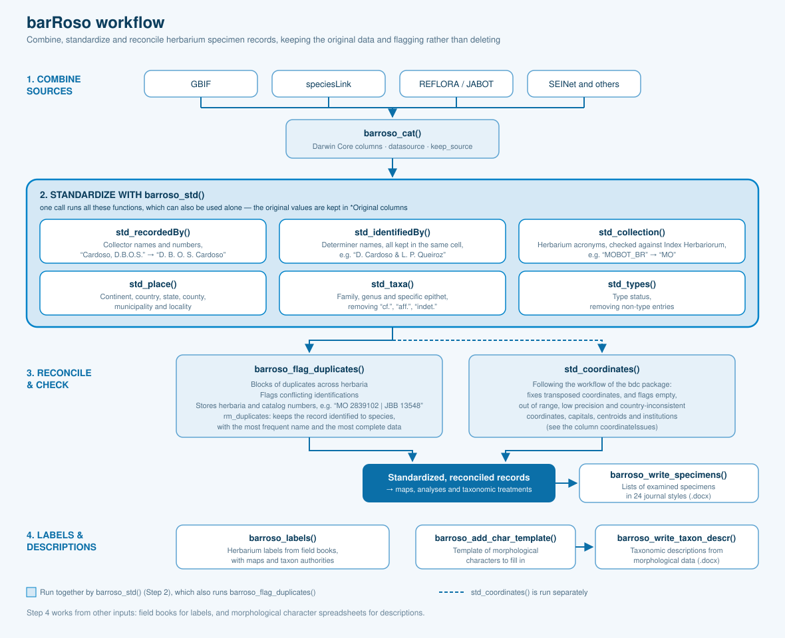

These "how-to" articles walk through `barRoso`'s functions in the order you would typically reach for them: combining sources, standardizing the records, reconciling duplicates and checking coordinates, and finally generating labels, lists of examined specimens and taxonomic descriptions. The diagram below gives the overall shape of that workflow before you dive into the individual guides.

::: {layout-ncol="2"}

::: {style="display: block;"}
### Data Standardization
- [Format Datasets into Darwin Core](/articles/format_darwin_core.qmd)
- [Compare Herbarium Sources](/articles/compare_herbarium_sources.qmd)
- [Fix Species Names](/articles/fix_names.qmd)
- [Standardize Specimen Records](/articles/standardize_specimens.qmd)
- [Update a Database with New Downloads](/articles/update_database.qmd)
- [Flexible Column Names](/articles/custom_column_names.qmd)
:::

::: {style="display: block;"}
### Duplicate Detection
- [Detect and Flag Duplicates](/articles/detect_duplicates.qmd)
- [Flag Identifications by Specialists](/articles/flag_specialists.qmd)
:::

::: {style="display: block;"}
### Geographic Coordinates
- [Fix and Flag Coordinates](/articles/fix_flag_coordinates.qmd)
:::

::: {style="display: block;"}
### Case Studies & Workflows  
- [Standardize GBIF Data](/articles/cleaning_gbif_data.qmd)
- [REFLORA Cleaning Workflow](/articles/case_study_reflora.qmd)
:::

::: {style="display: block;"}
### Herbarium Label Generation  
- [Generate Herbarium Labels](/articles/generate_herbarium_labels.qmd)
:::

::: {style="display: block;"}
### Write Examined Specimens
- [Write Lists of Examined Specimens](/articles/write_examined_specimens.qmd)
:::

::: {style="display: block;"}
### Write Taxonomic Descriptions  
- [Automatically generated taxonomic descriptions](/articles/write_taxonomic_descriptions.qmd)
:::

:::
