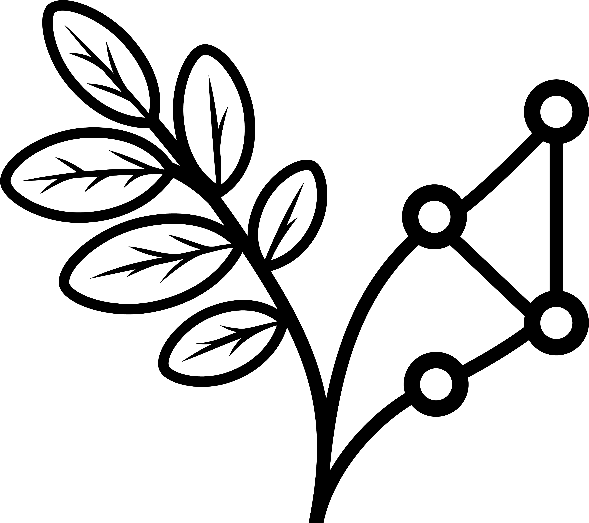

## barRoso

- [`barroso_cat()`](/reference/barroso_cat.qmd)

- [`barroso_chars_template()`](/reference/barroso_chars_template.qmd)

- [`barroso_dwc()`](/reference/barroso_dwc.qmd)

- [`barroso_fix_names()`](/reference/barroso_fix_names.qmd)

- [`barroso_flag_duplicates()`](/reference/barroso_flag_duplicates.qmd)

- [`barroso_flag_specialists()`](/reference/barroso_flag_specialists.qmd)

- [`barroso_labels()`](/reference/barroso_labels.qmd)

- [`barroso_std()`](/reference/barroso_std.qmd)

- [`barroso_write_descriptions()`](/reference/barroso_write_descriptions.qmd)

- [`barroso_write_specimens()`](/reference/barroso_write_specimens.qmd)

- [`dms_to_decimal()`](/reference/dms_to_decimal.qmd)

- [`rm_authors()`](/reference/rm_authors.qmd)

- [`std_collection()`](/reference/std_collection.qmd)

- [`std_coordinates()`](/reference/std_coordinates.qmd)

- [`std_dates()`](/reference/std_dates.qmd)

- [`std_identifiedBy()`](/reference/std_identifiedBy.qmd)

- [`std_place()`](/reference/std_place.qmd)

- [`std_recordedBy()`](/reference/std_recordedBy.qmd)

- [`std_taxa()`](/reference/std_taxa.qmd)

- [`std_types()`](/reference/std_types.qmd)

